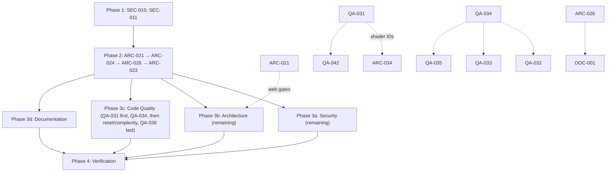

# Project Audit Report

> **Project**: par-fractal
> **Date**: 2026-09-28
> **Stack**: Rust 1.98 (Edition 2024), wgpu 29, winit, egui 0.35, WGSL, wasm32 web build
> **Audited by**: Claude Code Audit System (Opus 5 subagents, parsight-indexed)

---

## Executive Summary

The codebase is healthy in its security posture (no Critical or High security findings; `cargo audit` clean, zero `unsafe`, no tracked secrets) but has three Critical defects elsewhere: the **2D fragment shader draws the wrong attractor for 5 of 6 strange attractors** on every path that bypasses the Fractal Type panel (QA-031), the **web/WASM build has not compiled since 2026-07-19** because no local gate builds that target (ARC-021), and the **uniform-sync documentation still describes the pre-encase layout** and would guide a contributor into reintroducing the exact bug class ENH-008 removed (DOC-001). Two Medium security findings share one root cause — fields (`center_2d_precise`, `lod_config.quality_presets[*].iteration_scale`) that bypass the SEC-001 trust boundary let a crafted preset file exhaust CPU/RAM or hang the GPU, and auto-save persists the damage. Estimated effort to remediate Critical + High: roughly 2–3 focused weeks. A genuine strength: the render-on-demand and tile-refinement logic is pure functions with unit tests, and the deep-zoom math has a CPU reference mirror tested in CI.

---

## Issue Count by Severity

| Severity | Architecture | Security | Code Quality | Documentation | Total |
|----------|:-----------:|:--------:|:------------:|:-------------:|:-----:|
| 🔴 Critical | 1 | 0 | 1 | 1 | **3** |
| 🟠 High     | 5 | 0 | 5 | 7 | **17** |
| 🟡 Medium   | 8 | 2 | 3 | 10 | **23** |
| 🔵 Low      | 3 | 7 | 6 | 5 | **21** |
| **Total**   | **17** | **9** | **15** | **23** | **64** |

*After cross-domain dedup. Merged findings (primary ID ← duplicates): ARC-024←QA-037, ARC-030←QA-041, ARC-031←SEC-014, ARC-034←QA-038, ARC-033←(kept as QA-034), QA-039←ARC-037, QA-040←SEC-018, SEC-015←ARC-036, ARC-039←DOC-022.*

---

## 🔴 Critical Issues (Resolve Immediately)

### [QA-031] The 2D shader draws the wrong attractor for five of the six 2D strange attractors when accumulation is off
- **Area**: Code Quality (correctness)
- **Location**: `src/shaders/fractal.wgsl:3413-3422` vs `src/fractal/types.rs:56-61`
- **Description**: Rust sends shader IDs 26–31 for Hopalong, Martin, Gingerbreadman, Chip, Quadruptwo, Threeply. The `fs_main_2d` switch reads them differently: 27→`henon_attractor`, 28→`martin_attractor`, 29→`gingerbreadman_attractor`, 30→`latoocarfian_attractor`, 31→`chip_attractor`. Only Hopalong (26) matches; cases 32–34 (quadruptwo/threeply/icon) are unreachable. Broken since the attractors were added (`a7c04e9`); `gpu_discriminant_roundtrip` only checks the Rust side.
- **Impact**: "Martin" renders a Hénon map, "Chip" renders Latoocarfian, etc., on every path that skips the type panel's accumulation toggle — command palette, `--switch-after`, loaded settings, hidden-UI web start. The compute path (`attractor_index()`) matches correctly.
- **Remedy**: Renumber the shader cases to match the enum (drop henon/latoocarfian/icon arms or give them real variants); turn accumulation on inside `switch_fractal` for every `uses_accumulation()` type; add a test that `include_str!`s `fractal.wgsl` and cross-checks the switch against `FractalType as u32`.

### [ARC-021] The Web/WASM build is broken at HEAD, and no local gate builds it
- **Area**: Architecture
- **Location**: `src/web_main.rs:354` (6 args where `App::new_async` takes 7 — missing `profile_dump_path`, broken in `afb8cbe` 2026-07-19), `Makefile:213`, `.pre-commit-config.yaml`
- **Description**: `cargo check --lib --target wasm32-unknown-unknown --no-default-features --features web` fails (exit 101, 1 error + 13 warnings). `make checkall`, pre-commit and `make lint` build native only; CI's `web-build` job is dispatch-only. Every change since 2026-07-19 is unverified on web.
- **Impact**: `make web-build` and the GitHub Pages deploy fail; wasm-gated code is unmaintained.
- **Remedy**: Fix the call (or better, ARC-032's `AppOptions`); add a `web-check` Makefile target (`cargo clippy --lib --target wasm32-unknown-unknown --no-default-features --features web -- -D warnings`), wire it into `checkall` and pre-commit.

### [DOC-001] Uniform-sync guidance describes the pre-encase layout and would reintroduce the bug class ENH-008 removed
- **Area**: Documentation
- **Location**: `docs/ARCHITECTURE.md:380,588,645-745,965-989,1044-1049`; `docs/README.md:208-211`; `CLAUDE.md:127,139,193`; `src/fractal/types.rs:4`
- **Description**: ARCHITECTURE.md still documents `#[repr(C)]` + bytemuck + manual `_padding*` + 864 bytes and a hard-coded size assert; the code is encase-derived, 768 bytes, no padding, no assert. Docs name a nonexistent `FractalUniforms` struct and a nonexistent `params.to_uniforms()`.
- **Impact**: A contributor following the checklist hand-pads an encase-derived struct — the silent-corruption bug class ENH-008 eliminated.
- **Remedy**: Replace the five stale ARCHITECTURE sections with the encase procedure CLAUDE.md already documents correctly; rename `FractalUniforms`→`Uniforms` everywhere; remove `to_uniforms()` references. (Sequence after ARC-026/027/034, which change the uniform set and its size.)

---

## 🟠 High Priority Issues

### [ARC-022] Bloom blur's H and V passes share one uniform buffer — bloom is never a 2D blur
- **Area**: Architecture
- **Location**: `src/renderer/initialization.rs:458-464,929-946`; `src/app/render.rs:714-718`; `src/app/capture.rs:478-515,602`; `src/app/capture_web.rs:408-445,530`
- **Description**: Both blur bind groups bind the same `blur_uniform_buffer`; direction is switched by `queue.write_buffer` between passes in one encoder — but wgpu applies all queued writes before the next `submit`, so the last write wins for the whole submission. Interactive frames blur vertically twice; hi-res exports blur horizontally twice.
- **Impact**: Bloom is a one-dimensional streak, and it is oriented differently on screen vs exports.
- **Remedy**: Two uniform buffers at init, (1,0) and (0,1), one per bind group; delete all four per-frame blur `write_buffer` calls; add a bloom-enabled golden image.

### [ARC-023] The post-processing chain exists three times; App encodes GPU passes through ~60 public Renderer fields
- **Area**: Architecture
- **Location**: `src/app/render.rs:643-848`; `src/app/capture.rs:185-564`; `src/app/capture_web.rs:131-490`; `src/renderer/mod.rs:52-184`
- **Description**: The bloom/blur/composite/final passes are hand-written in three places and have diverged: exports use full-res bloom targets so exported bloom is half as wide; exports always run `copy_pipeline` so FXAA never appears; exports always composite so accumulation-mode exports get grading/vignette the screen never shows.
- **Impact**: Captures don't match the screen; every post-processing change is a three-site edit.
- **Remedy**: Extract a `renderer::PostChain` owning targets/bind-groups/pass encoding (`encode(encoder, scene_view, output, PostOptions)`); one sized to the surface, a temporary one at capture size; make Renderer fields private behind encode methods.

### [ARC-024] The binary recompiles the whole module tree instead of using the library crate
- **Area**: Architecture (merges QA-037)
- **Location**: `src/main.rs:1-20`; `src/lib.rs:39-72`; `Cargo.toml:33-34`
- **Description**: `main.rs` re-declares every `mod`, so rustc compiles two module trees (~double binary compile time). Consequences: parsight reports `App::render/update/resize` as zero-caller dead code; `#[allow(dead_code)] mod platform` exists only to silence the duplicate; `reference` is missing from the binary's tree; `cdylib` links a native dylib on every build for an artifact only wasm needs.
- **Impact**: Compile time, unreliable lint/dead-code signals, library API can break unnoticed.
- **Remedy**: `main.rs` becomes a thin `use par_fractal::…` shim; delete its `mod` tree and the allow; expose `clear_settings_files` etc. from the lib; optionally move wasm `cdylib` to a workspace member. **Must land before any dead-code cleanup** (QA-046/047) — it changes what clippy flags.

### [ARC-025] Keyboard, command-palette and UI changes each skip different parts of dirty-marking, undo and persistence
- **Area**: Architecture
- **Location**: `src/app/input.rs` (37 `mark_scene_dirty`, no `settings_need_save`); `src/ui/mod.rs:588-597`; `src/app/render.rs:917-927`; `src/ui/panels/settings.rs:105-110,174`; `src/fractal/mod.rs:479-502`; `src/ui/panels/palette.rs:571-575`; `src/main.rs:544`
- **Description**: Hotkey changes and 2D pan/zoom never schedule autosave (lost on quit); undo history is recorded only inside `UI::render` (palette/hotkey changes merge into the next panel change); the "Save Settings" button writes the legacy `settings.yaml` with a placeholder camera and default UIState while the loader reads `settings/settings.yaml` first; loading a custom palette writes `palette.colors` directly, breaking the `palette_index`-derived invariant, and is lost on reload.
- **Impact**: Users silently lose state; undo is inconsistent; the manual save button is a no-op or harmful.
- **Remedy**: Route every mutation through one command path — hotkeys emit `CommandAction`s; one `App::commit_change()` does dirty+history+autosave+reframe; replace `save_to_file` with `save_all_settings`; save on `CloseRequested`; represent palettes as `PaletteSource::{Builtin, Custom}` persisted in `Settings`.

### [ARC-026] The parameter model is hand-copied across four ~80-field structs whose defaults disagree
- **Area**: Architecture
- **Location**: `src/fractal/state.rs:51-290`; `src/fractal/settings.rs:24-205`; `src/fractal/mod.rs:135-473`; `src/renderer/uniforms.rs:127-593`; `src/shaders/fractal.wgsl:6`
- **Description**: `RenderSettings`, `Settings`, Rust `Uniforms` and WGSL `Uniforms` each list the parameter set; `to_settings`/`from_settings` copy field-by-field (~330 lines). Defaults disagree: `attractor_iterations_per_frame` 10,000 (code) vs 100,000 (serde); `attractor_log_scale` 4.0 vs 1.0; `Uniforms::new` uses different lighting/bloom than both.
- **Impact**: A settings file missing a key loads differently from a fresh start; adding one parameter means ~10 edits.
- **Remedy**: Derive serde on `RenderSettings` with `#[serde(default)]` + `#[serde(flatten)]` in `Settings` (gated by `tests_default_settings.yaml`); move trust-boundary clamps into `RenderSettings::sanitize()`; `#[serde(skip)]` the derived `palette`/`render_mode`; build `Uniforms::new()` from `FractalParams::default()`. **Security must re-review the clamp move (SEC-010/011 land first); DOC-001 waits for it.**

### [QA-032] The R key (reset view) does not reset the view in either 2D or 3D
- **Area**: Code Quality
- **Location**: `src/app/mod.rs:928-953`; `src/camera.rs:33`; `README.md:245`; `docs/CONTROLS.md:88`
- **Description**: 2D: R calls `switch_fractal(current_type)`, which for escape-time types only restores `power`/`max_iterations` — center and zoom stay — and it overwrites the user's power/iterations. 3D: R rebuilds `Camera::new` (fixed z=5) without updating `framed_for`, so framing never corrects it; Octahedral/Icosahedral/Apollonian reset to a camera *inside* the structure.
- **Impact**: The documented reset shortcut is broken for the most common fractals and silently mutates parameters.
- **Remedy**: One shared `reset_view` using the per-type 2D default center/zoom table (from QA-034's `FractalInfo`) and `apply_default_camera_for_fractal()` + `note_camera_framed()` for 3D.

### [QA-033] Four "reset" entry points behave four different ways
- **Area**: Code Quality
- **Location**: `src/ui/command.rs:382-393`; `src/ui/panels/rendering.rs:464-469`; `src/app/render.rs:1136-1165`; `src/app/mod.rs:928`
- **Description**: The panel's Reset View clears `center_2d_precise`; the palette's `ResetView` does not (stale deep-zoom center survives); palette `ResetAll` leaves the camera; settings-panel reset also resets the camera; each hard-codes `[0,0]`/`1.0`.
- **Impact**: Reset results depend on trigger; deep-zoom state can go stale.
- **Remedy**: Route all four through `App::reset_view`/`App::reset_all` (QA-032 implementation); command palette returns actions instead of mutating params.

### [QA-034] Per-fractal-type knowledge is scattered across 10+ hand-written tables (shotgun surgery)
- **Area**: Code Quality (merges ARC-033, whose lower-severity findings fold in)
- **Location**: `src/fractal/mod.rs:235-271,513-549` (two identical 35-arm `RenderMode` matches); `src/fractal/types.rs` (`filename_safe_name` cx36, `attractor_index`, `default_camera_distance`); `src/fractal/mod.rs:552-707,732-751`; `src/ui/panels/fractal_type.rs`; `src/command_palette.rs`; `src/app/input.rs:94-215`; `src/fractal/tests.rs:590-640`
- **Description**: `FractalType` has no `ALL` constant and no per-type metadata struct. In-app help has already drifted: it says "F6: Tglad Formula"/"F11: Hybrid Bulb-Julia" while code binds F6 to Octahedral IFS and nothing to F11.
- **Impact**: Adding a fractal type = editing ~10 files; this pattern produced QA-031 and the "keep in sync" test comment.
- **Remedy**: `FractalType::ALL` + `const fn info() -> &'static FractalInfo { label, filename, dim, camera_distance, defaults fn, hotkey, accumulation }`; collapse both `RenderMode` matches to `is_3d()`; drive UI, palette, randomize, hotkeys, help and tests from `ALL`.

### [QA-035] Six UI and input functions have critical cyclomatic complexity (40+)
- **Area**: Code Quality
- **Location**: `src/app/input.rs:8` `App::input` (cx68, 495 lines); `src/ui/panels/palette.rs:11` (cx66, whole 600-line file); `src/ui/command.rs:154` `execute_command` (cx52); `src/ui/panels/presets.rs:11` (cx48); `src/main.rs:157` `main` (cx46); `src/ui/panels/capture.rs:16` (cx44)
- **Description**: `input` is one keycode match whose 11 fractal-switch arms differ only by `FractalType`; `execute_command` repeats the same toggles and magic numbers (32, 2048, 10, 500, 0.5, 2.0–16.0, 0.1–5.0) and a shadow-mode name table duplicated from `input.rs:407`; `main` is a hand-rolled arg parser repeating the same flag pattern per flag.
- **Impact**: Constants drift between paths by hand; none of these functions is testable.
- **Remedy**: Hotkeys map to `CommandAction` through the single `execute_command` (consts hoisted); argument loop → `clap` derive or a `(flag, arity, parser)` table; split the palette/preset panels per collapsing group. **Sequence after QA-034** (use its metadata table, not another enumeration).

### [QA-036] Integration tests mostly check that a field holds the value just written to it
- **Area**: Code Quality
- **Location**: `tests/integration_tests.rs:23-57,103-144,146-170`; `src/ui/tests.rs`; `src/fractal/tests.rs:126-143`
- **Description**: Assign-then-assert tests (`test_shading_model_switching`, `test_2d_fractal_parameters`); `test_all_palettes_exist` hard-codes 22 names by index. No test exercises input, reset or command paths — which is why QA-031/032/033 shipped. Zero tests in `app/input.rs`, `app/render.rs`, `ui/command.rs`, `switch_fractal`, `parse_pal_content`, `parse_url_params`, the arg parser, `handle_ui_actions`.
- **Impact**: The suite passes while user-visible behavior is wrong.
- **Remedy**: Replace vacuous tests with behavior tests (reset restores per-type center; every `uses_accumulation()` type has accumulation on after `switch_fractal`; palette and hotkey produce identical state); unit-test `parse_pal_content`, `parse_url_params`, and an extracted `parse_args`.

### [DOC-002] 0.9.0 and 0.10.0 are documented as released but are neither tagged nor on crates.io
- **Area**: Documentation (release decision required)
- **Location**: `CHANGELOG.md:106,285,611-612`; `README.md:16,36,176-186`; `docs/QUICKSTART.md:45-57`
- **Description**: Remote tags end at `v0.8.3`; crates.io `max_version` is 0.8.3. The `[0.10.0]`/`[0.9.0]` compare links 404. README recommends `cargo install par-fractal`, which gets 0.8.3 without Deep Zoom or the profiler.
- **Impact**: The recommended install path doesn't deliver documented features; version history links are dead.
- **Remedy**: **Decision needed**: tag+publish 0.9.0/0.10.0 through the release workflow, or fold both sections under `[Unreleased]`. Then align README feature claims. DOC-006/DOC-016 follow this decision.

### [DOC-003] Documented GPU backend forcing (`WGPU_BACKEND`) does nothing
- **Area**: Documentation / code decision
- **Location**: `docs/QUICKSTART.md:421-428`; `CLAUDE.md:63-70`; `Makefile:510-525`; `src/renderer/initialization.rs:16-17,53-55`
- **Description**: The renderer hard-sets `Backends::all()` via `InstanceDescriptor::new_without_display_handle()`; in wgpu 29 nothing reads `WGPU_BACKEND` unless `with_env`/`new_without_display_handle_from_env` is called (verified against wgpu-core/wgpu-hal 29.0.4).
- **Impact**: The black-screen troubleshooting step and four Makefile targets fail silently.
- **Remedy**: **Decision needed**: switch both constructors to `new_without_display_handle_from_env()` (preferred — keeps the documented workflow), or remove the docs and Makefile targets.

### [DOC-004] The CLI reference lists 7 of the 14 options the binary accepts
- **Area**: Documentation
- **Location**: source of truth `src/main.rs:29-53`; stale copies `CLAUDE.md:73-82`; `docs/README.md:298-331`; `docs/FEATURES.md:412-421`; `docs/ARCHITECTURE.md:163-169`
- **Description**: `--profile-dump`, `--switch-after`, `--camera-pos`, `--resize-after` are documented nowhere outside `--help`; `--window-size`/`--screenshot-path` only in an ARCHITECTURE harness paragraph.
- **Impact**: The CLI's main consumers (automation, agent-operability) can't find its options.
- **Remedy**: One complete CLI table in FEATURES.md (flags, args, units, examples); other docs link to it.

### [DOC-005] Perturbation deep zoom is effectively undocumented and the 2D guide contradicts it
- **Area**: Documentation
- **Location**: `docs/FRACTALS2D.md:81-107,146,255,261`; `docs/CONTROLS.md:337`; `docs/ARCHITECTURE.md` (no `deep_zoom` section)
- **Description**: Only the double-float path is documented with a "practical ceiling ~1e11"; the ENH-001 perturbation path (`src/deep_zoom/`, gate `PERTURBATION_LOG2_GATE = 13.3`), its covered types (Mandelbrot/Julia/Burning Ship/Tricorn), and the precise-center UI are absent. ARCHITECTURE has no section for `deep_zoom/` or the reference-orbit worker.
- **Impact**: The headline 0.10.0 feature is a one-line bullet; the user guide states a ceiling that is no longer true.
- **Remedy**: Rewrite "High-Precision Zoom Mode" as "Deep Zoom" (both paths, thresholds, types, UI); add an ARCHITECTURE `deep_zoom` subsection with a data-flow diagram.

### [DOC-006] The in-app About page is out of sync with CHANGELOG.md
- **Area**: Documentation
- **Location**: `src/ui/panels/about.rs:59-91`
- **Description**: "What's New in v0.9.0" lists 0.8.3 content (egui 0.35/edition-2024); the real 0.9.0 remediation is missing; no 0.8.1/0.8.3 entries; nothing reflects `[Unreleased]`. CLAUDE.md and CONTRIBUTING.md both require sync.
- **Impact**: Users see wrong release notes inside the app.
- **Remedy**: Regenerate entries from CHANGELOG.md after the DOC-002 version decision; consider build-time generation.

### [DOC-007] Documented undo/redo shortcuts and double-click zoom are not implemented
- **Area**: Documentation (needs implement-or-remove decision)
- **Location**: `README.md:248`; `docs/FEATURES.md:388-389`; `src/ui/mod.rs:477,490` (tooltips); `docs/FRACTALS2D.md:79,118`
- **Description**: No `KeyZ`/`KeyY` handler exists (undo/redo are buttons only); no double-click handling anywhere; README says redo is Shift+Z while the tooltip says Ctrl+Y.
- **Impact**: Users press shortcuts that do nothing; docs disagree with each other.
- **Remedy**: Filed as enhancement **ENH-002** (implement Ctrl/Cmd+Z, one redo binding, double-click zoom). DOC-007's doc edits follow whatever ENH-002 ships.

### [DOC-008] The settings location/format documentation is wrong on every platform
- **Area**: Documentation
- **Location**: `CLAUDE.md:221-256`; `docs/ARCHITECTURE.md:209-222`
- **Description**: macOS actually resolves to `~/Library/Application Support/com.fractal.par-fractal/` (verified), not `~/.config/par-fractal/`; Windows is `%APPDATA%\fractal\par-fractal\config`, not `%APPDATA%\par-fractal\`; the file is `settings/settings.yaml` (legacy fallback `settings.yaml`) with flat keys, not the nested sample shown; `preferred_gpu_index` lives in `preferences.yaml`; ARCHITECTURE says persistence is "Native Only" but the web build saves to localStorage; no user-facing doc says where settings live.
- **Impact**: Users can't find, back up, or hand-reset settings.
- **Remedy**: Add a "Configuration Files" section to QUICKSTART.md (per-OS table + web note); fix CLAUDE.md paths/sample; fix the ARCHITECTURE "Native Only" claim.

---

## 🟡 Medium Priority Issues

### Architecture

- **[ARC-027]** Nothing validates the Rust/WGSL uniform contract against shader source. `uniforms_byte_layout` compares encase output to hard-coded offsets; no shader is ever compiled in tests; a WGSL-only change passes everything. Remedy: `naga = "=29.0.4"` (wgsl-in) as a dev-dependency; a test validating all six shaders and comparing naga's struct layouts to encase's for `Uniforms`, `BloomUniforms`, `PostProcessUniforms`, and the compute/display uniforms.
- **[ARC-028]** Two independent cfg axes; the `web` feature is never referenced in code. 9 `feature = "native"` sites vs 94 `target_arch = "wasm32"` sites; `cargo check --lib --no-default-features` fails with 45 errors. Remedy: gate on target only; move deps into target-specific `dependencies` tables; update `Trunk.toml`/`index.html`. Sequence after ARC-021.
- **[ARC-029]** Platform abstraction half-adopted: presets/bookmarks/palettes/preferences call `ProjectDirs` directly in 20 places; `FileDialog` trait unused; wasm stubs report galleries as unsupported although `WebStorage` can serve them. Remedy: route all galleries through `Storage` categories; pass `&dyn Storage` in; single `config_dir()` helper.
- **[ARC-030]** Blocking I/O on the render thread (merges QA-041): `AppPreferences::load()` every frame the settings panel is open; `App::resize` does load+save `preferences.yaml` per resize event (no debounce, no `is_headless()` guard — harness runs overwrite the user's window size); video readback does `device.poll(Wait)` per frame. Remedy: cache `AppPreferences`; debounce window-size save through the existing 1-second autosave behind `is_headless()`; async staging-buffer ring for video readback.
- **[ARC-031]** Hi-res capture ignores device limits (merges SEC-014): device requested with `Limits::default()` (max_texture_dimension_2d = 8192) while UI and the SEC-009 clamp allow 16384; five full-res Rgba16Float targets at 8192² = 2.5 GiB; `request_device().unwrap()` panics on incapable adapters. Remedy: request adapter-offered limits, store `max_texture_dimension_2d` on Renderer, clamp UI/capture to it, tile exports above the limit (reuse `app/refine.rs` scissor tiles), handle device-creation errors.
- **[ARC-032]** `App` is a god object with a 7-positional-`Option` constructor repeated across `new`, `new_async`, `init_common`, `AppHandler`. Remedy: `AppOptions` struct with `Default` (this alone fixes ARC-021's signature drift class); group state into `InputState`/`HarnessState`/`FrameScheduler`/`AutosaveState`.
- **[ARC-034]** `fractal.wgsl` carries a dead post-processing path fed by 12 uniform fields with no reader (merges QA-038): `apply_post_processing` uncalled makes `extract_bloom`, grading, vignette, `apply_fxaa` and the HSV helpers unreachable; `brightness`→`fxaa_enabled` written every frame, read by nobody; also unused `box_fold`, `sphere_fold`, `sample_disk`, identity-stub `apply_fxaa`, and (~150 lines of) `henon/latoocorfian/icon_attractor` bodies that die with QA-031. Remedy: delete dead WGSL + the 12 fields on both sides; update the layout test (768-byte size changes) and CLAUDE.md's size claim.
- **[ARC-035]** A 930-line `initialize_with_adapter` constructor with `recreate_textures` duplicating the whole texture/bind-group graph for resize. Remedy: split into `create_device`, `create_fractal_pipelines`, `PostChain::new` (ARC-023), `create_accumulation_resources`; init and resize share bind-group builders.

### Security

- **[SEC-010]** `center_2d_precise` bypasses the SEC-001 trust boundary: `parse_center_decimal` feeds dashu with unbounded exponents. Measured: `1e1000000000` = 46.5 s CPU + 3.4 GB RSS; `1e9223372036854775807` panics with `out of memory`; worker `Disconnected` sets `dirty = true` so panics retry every eligible frame; pasted coordinates run the same parse on the UI thread; SEC-006 import warning doesn't cover the field. Remedy: lexical pre-check inside `parse_center_decimal` (len cap 4096; exponent digits ≤4 after sign); reject magnitude >1e15 post-parse; validate in `from_settings` and drop invalid pairs to `None`; backoff/cap the retry; add the field to the SEC-006 warning; fix the now-false `from_settings` doc comment.
- **[SEC-011]** `lod_config.quality_presets[*].iteration_scale` bypasses the trust boundary: `1e30` saturates the cast to `u32::MAX` iterations per pixel, defeating the SEC-001 clamp of `max_iterations`; likely GPU watchdog/device loss; persisted by auto-save. Remedy: sanitize every `QualityLevel` in `from_settings` (finite-only; `iteration_scale` ∈ [0,1], `render_scale` ∈ [0.25,1], counts at SEC-001 ceilings — a `QualityLevel::sanitized()` helper in `src/lod.rs`); clamp `effective_2d_max_iterations` to `perturbation_max_iterations` as a second layer; add LOD fields to the SEC-006 warning. (`min_quality_level` was checked and ruled out.)

### Code Quality

- **[QA-039]** `rgb_to_hsv`/`hsv_to_rgb` duplicated in `fractal.wgsl:3165-3219` and `postprocess.wgsl:151-205`; `world_to_screen` near-duplicated in `attractor_compute.wgsl:137` and `buddhabrot_compute.wgsl:64`. Remedy: shared `src/shaders/common.wgsl` joined with `concat!(include_str!…)` at load time.
- **[QA-040]** GPU initialization panics with no message (merges SEC-018): `create_surface/request_adapter/request_device .unwrap()` at `initialization.rs:57,95,106,123,177`, `main.rs:420,449`; `WebStorage::new` panics when localStorage is blocked. Remedy: `Result<Self, RendererInitError>` from constructors; stderr on native, `#error` element on web; in-memory storage fallback; split `initialize_with_adapter` (overlaps ARC-035).
- **[QA-042]** The accumulation condition is re-derived in five places with two spellings (`render.rs:73-76`, `renderer/update.rs:274-276`, `capture.rs:373-379`, `app/mod.rs:722-725,818-820`). Remedy: `FractalParams::accumulation_active()`; lands naturally after QA-031's `switch_fractal` change.

### Documentation

- **[DOC-009]** Docs say `render_scale` is "not currently applied" (FEATURES:455, ARCHITECTURE:866, FRACTALS3D:1385); it has been applied since 0.10.0. Remedy: describe dynamic render scaling.
- **[DOC-010]** `CONTRIBUTING.md:7` still says MSRV 1.85; `Cargo.toml` says 1.98. Remedy: reference `rust-version` instead of repeating numbers.
- **[DOC-011]** rustdoc emits 11 warnings (6 unresolved intra-doc links, 5 links to private items); CI has no doc gate. Remedy: fix links; add `RUSTDOCFLAGS=-D warnings cargo doc --no-deps` to CI and `make checkall`.
- **[DOC-012]** ~59% of public items documented; 22 files lack module docs; weakest: `palettes.rs` (6/65), `presets.rs` (12/43), `ui_state.rs` (1/16), `camera_transition.rs` (0/4). Remedy: module docs + gallery/preset/palette API docs incl. error conditions; consider `#![warn(missing_docs)]` on the lib.
- **[DOC-013]** ARCHITECTURE.md module map/type listings stale: component diagram omits `deep_zoom/`, `renderer/{compute,orbit_buffer,profiler}.rs`, `app/{refine,capture_common,capture_web}.rs`, `ui/panels/*`; `LODState.camera_velocity` shown as `Vec3` (it's `f32`); preset categories wrong; type 25 "reserved" (it's Buddhabrot2D); `NativeCapture` saves to cwd not "Pictures"; `docs/README.md` shows the pre-split layout. Remedy: regenerate the map from `src/`; replace struct dumps with summaries.
- **[DOC-014]** "Adding a New Fractal" checklists stale and omit the steps behind recent bugs (no `switch_fractal` seeding step, no camera-distance step; reference nonexistent `map()`; match-arm step obsolete). Remedy: one checklist in CONTRIBUTING or ARCHITECTURE; CLAUDE.md links to it. After DOC-001.
- **[DOC-015]** FRACTALS3D.md ranges/defaults stale: "Fractal Scale (0.5-5.0)" vs actual 0.05..=5.0 log slider; Pickover/Lorenz/Rossler defaults 1.0 vs code 0.3/0.05/0.1; Rossler dt 0.01/500 transient vs code 0.02/2000. Remedy: cite `FRACTAL_SCALE_RANGE` etc. instead of repeating numbers.
- **[DOC-016]** CHANGELOG hygiene: 0.8.1 above 0.8.2; no `[Unreleased]` compare link; "~1e6e7" typo; ENH-002 tile-progressive refinement missing. Remedy: reorder, add link, fix, add entry. After DOC-002.
- **[DOC-017]** No env-var reference or release runbook: `RUST_LOG`, `PAR_REFINE_FORCE_SIDE` undocumented; release needs `CARGO_REGISTRY_TOKEN`, `HOMEBREW_TAP_TOKEN`, `DISCORD_WEBHOOK` via `workflow_dispatch` — none documented. Remedy: `docs/RELEASING.md`; env-var table. (Likely explains DOC-002's unpublished versions.)
- **[DOC-018]** CONTROLS/QUICKSTART/FEATURES UI claims don't match the implementation: video formats (no WebM/quality/duration controls as documented), nonexistent preset thumbnail-preview/share-link, "panel fixed to right" (it's a movable window), "Esc exits fullscreen" (no fullscreen), Shift+G missing from CONTROLS. Remedy: rewrite capture/preset sections from the panel sources; add Shift+G.

---

## 🔵 Low Priority / Improvements

### Architecture
- **[ARC-037]** Duplicated helpers across entry points/shaders: `parse_quality_level` identical in `main.rs:56`/`web_main.rs:16`; the two `window_event` handlers (similarity 0.975); `hash`/`world_to_screen` duplicated between compute shaders. Remedy: Rust helpers into the lib; WGSL via load-time concat (shares QA-039's mechanism).
- **[ARC-038]** Hand-rolled CLI parser (cx46), per-flag error handling, unvalidated delays (can be negative/non-finite). Remedy: clap derive or table-driven parser; overlaps QA-035/ENH-003.
- **[ARC-039]** Repo hygiene (merges DOC-022): `todos.md` tracked despite `.gitignore`, `plan.md` tracked at root (says mobile touch "IN PROGRESS"; shipped 0.5.0; `todos.md` lists nonexistent attractors and ships in the crate — add to Cargo `exclude`). Remedy: remove/archive both.

### Security
- **[SEC-012]** `CustomPaletteGallery` skips `sanitize_name` (save/load/delete join filenames directly). All current callers are safe; the type is public API. Remedy: `pub(crate) sanitize_name` called in all three methods; fix its stale doc reference.
- **[SEC-013]** Preset camera `fovy`/`camera_speed` applied raw from `preset.settings` instead of the clamped params; `camera_position`/`target` never finiteness-checked (NaN → NaN view-projection, persisted). Remedy: read from clamped params; non-finite → per-type default framing.
- **[SEC-015]** Dependency hygiene (merges ARC-036): stale `RUSTSEC-2026-0194/0195` ignores (quick-xml now 0.41.0 — fixed version; would hide a downgrade regression); keep the ttf-parser one; `serde_yaml 0.9.34+deprecated` parses all local configs (do **not** migrate to `serde_yml` — RUSTSEC-2025-0068). Remedy: prune stale ignores; evaluate a maintained YAML replacement against `tests_default_settings.yaml` as the compatibility gate.
- **[SEC-016]** Release pipeline hardening: top-level `contents: write` + `id-token: write` for every job; `cargo publish --token ${{ secrets… }}` on argv (env var already set) with `|| echo` + `continue-on-error` hiding failures; tap token embedded in clone URL; `dtolnay/rust-toolchain@stable` unpinned (34 refs not SHA-pinned); no checksums/signatures. Remedy: per-job least privilege; drop `--token`; `gh auth setup-git`; SHA-pin; publish `SHA256SUMS`.
- **[SEC-017]** Unsigned/unnotarized macOS app; docs instruct `sudo xattr -d com.apple.quarantine` justifying it as "notarization requires paid developer account" — the maintainer holds Developer ID `QMLVG482FY`. Remedy: `codesign --options runtime` + `notarytool` in the release job; remove the xattr instructions.
- **[SEC-019]** Add `#![forbid(unsafe_code)]` to `lib.rs` and `main.rs` (no `unsafe` exists today).
- **[SEC-020]** gitleaks false positive on the style guide's `Bearer <TOKEN>` example. Remedy: `.gitleaksignore` fingerprint entry.

### Code Quality
- **[QA-043]** Stale wire-format comments: `uniforms.rs:140` ("2: Mandelbulb, 3: Menger" — actually 13/14); `types.rs:63` ("32-34 reserved" — the shader dispatches there); `fractal_type.rs:141` points at `todos.md`. Fix alongside QA-031.
- **[QA-044]** `ProceduralPalette::shader_index()` duplicates the discriminant (doc comment already says deprecated). Replace the one call site (`uniforms.rs:462`) with `as u32` and delete.
- **[QA-045]** Production `unwrap()`s guarded by checks lines earlier (`rendering.rs:406,411`; `render.rs:488,490`; `compute.rs:306`; `input.rs:656`). Convert to `let … else` so guard and use can't drift.
- **[QA-046]** `#[allow(dead_code)]` on test-only camera helpers (`camera.rs:271,308-338`). `#[cfg(test)]`-gate instead. After ARC-024.
- **[QA-047]** The two `VideoFormat` enums (wasm stub `ui/mod.rs:175-193` vs `video_recorder.rs:12-61`) drifted; encoder inlines codec/pixel-format arms. One platform-neutral enum; encoder calls `codec()`/`pixel_format()`.
- **[QA-048]** `reference.rs:234` `finalize_std` takes a `bail` parameter only to `let _ = bail;`. Remove or use it.

### Documentation
- **[DOC-019]** Screenshot filename claims wrong: F12 writes `{fractal}_{timestamp}.png`, not `{fractal}_{WxH}_{timestamp}.png` (that's hi-res only); save location is cwd. Fix QUICKSTART/FRACTALS2D/ARCHITECTURE.
- **[DOC-020]** Style-guide violations: ~45 fenced blocks without language tags; Mermaid per-node `style` instead of `classDef`; Rust version repeated 8 times. Tag blocks, convert diagrams, cite `rust-version`.
- **[DOC-021]** README redundancy: prose inside the install code block; Contributing repeats CONTRIBUTING.md.
- **[DOC-023]** Source paths in docs written `src/`-less (~65 medium-confidence broken doc-to-code links). Prefix paths.

---

## Detailed Findings

Full per-domain agent reports (including exact line references, exploit scenarios, measured numbers, false-positive exclusions, and per-domain file maps) are preserved in the session transcript. Everything above is deduplicated and severity-adjusted across the four domains. Notable exclusions kept as false positives: WGSL entry points and winit-dispatched methods reported by parsight as dead code; `two_prod`'s deliberate CPU/shader mirror; the command palette still listing 3D attractors (belongs to the existing "Re-enable 3D strange attractors" backlog card).

---

## Remediation Roadmap

### Immediate Actions (before anything else)
1. ARC-021 — restore the web build and add the `web-check` gate.
2. SEC-010, SEC-011 — close the two trust-boundary bypasses in `from_settings`.
3. QA-031 — fix the 2D attractor shader dispatch.

### Short-term
ARC-022, ARC-023, ARC-024, ARC-025, ARC-026, QA-032, QA-033, QA-034, QA-035, QA-036, DOC-001, DOC-002 (decision), DOC-003 (decision), DOC-004–008.

### Long-term (backlog)
All Medium and Low findings, plus the enhancement cards (ENH-001..003) filed on the board.

---

## Positive Highlights

1. Zero `unsafe` code in `src/`; `cargo audit` clean across 391 crates; no secrets tracked (one gitleaks false positive in a style-guide example).
2. ffmpeg is spawned with an args array, no shell; output filenames are app-generated and cannot start with `-`.
3. The SEC-001 trust boundary (NaN-safe clamps in `from_settings`) is real and tested — two fields escaped it; the rest of the surface holds.
4. `sanitize_name` path-traversal protection with tests covers presets and bookmarks.
5. Render-on-demand, converged fast-path and tile-refinement decisions are pure functions with unit tests.
6. encase-derived uniform layout plus the `uniforms_byte_layout` byte-pattern test eliminated the hand-padding bug class.
7. Deep-zoom math has a CPU f64 reference mirror and dedicated precision tests (`tests/perturb_math.rs`, `tests/reference_math.rs`) that run without a GPU.
8. Comments explain constraints and past incidents rather than restating code; CHANGELOG entries give root cause, fix and measured impact.
9. Module dependencies point one way: `fractal`/`lod`/`camera` depend on nothing in `renderer`/`ui`/`app`.
10. Core keybinding tables in CONTROLS.md match `input.rs` exactly, including step sizes and clamps.

---

## Audit Confidence

| Area | Files Reviewed | Confidence |
|------|---------------|-----------|
| Architecture | ~35 | High (two findings verified by building: wasm and no-default-features both fail) |
| Security | ~25 | High (DoS scenarios measured in a scratch crate against the lockfile's dashu; GPU scenario bounded, not run) |
| Code Quality | ~32 | High (parsight analytics + targeted reads; complexity numbers from the graph) |
| Documentation | ~40 | High (every doc claim checked against source, cargo doc, remote tags and crates.io) |

---

## Remediation Plan

> This section is generated by the audit and consumed directly by `/fix-audit`.
> It pre-computes phase assignments and file conflicts so the fix orchestrator
> can proceed without re-analyzing the codebase. Per-issue execution detail
> (steps, method, verify commands) is in `AUDIT-REMEDIATION-PLAN.md`, whose
> entry order matches the phases below.

### Phase Assignments

#### Phase 1 — Critical Security + promoted conflict issues (Sequential, first)
<!-- SEC-010/011 promoted: both edit `FractalParams::from_settings`, the single trust boundary that ARC-026 restructures and that several QA issues touch. -->
| ID | Title | File(s) | Severity |
|----|-------|---------|----------|
| SEC-010 | `center_2d_precise` trust-boundary bypass (CPU/RAM exhaustion, panic retry loop) | `src/deep_zoom/orbit.rs`, `src/fractal/mod.rs`, `src/deep_zoom/driver.rs`, `src/ui/panels/rendering.rs`, `src/ui/panels/presets.rs` | Medium (promoted) |
| SEC-011 | LOD `iteration_scale` trust-boundary bypass (GPU exhaustion) | `src/fractal/mod.rs`, `src/lod.rs`, `src/renderer/uniforms.rs`, `src/ui/panels/presets.rs` | Medium (promoted) |

#### Phase 2 — Critical/blocking Architecture (Sequential)
<!-- ARC-021 is Critical and blocks verification on every wasm-gated file.
     ARC-023/024/026 promoted: each blocks Code Quality or Documentation work on files it restructures. -->
| ID | Title | File(s) | Severity | Blocks |
|----|-------|---------|----------|--------|
| ARC-021 | Web/WASM build broken; add `web-check` gate | `src/web_main.rs`, `Makefile`, `.pre-commit-config.yaml` | Critical | all wasm-gated verification |
| ARC-024 | Binary uses the library crate (merge QA-037) | `src/main.rs`, `src/lib.rs`, `Cargo.toml` | High | QA-046, QA-047, dead-code sweeps |
| ARC-026 | Derive `RenderSettings` serde; unify defaults | `src/fractal/state.rs`, `src/fractal/settings.rs`, `src/fractal/mod.rs`, `src/renderer/uniforms.rs`, `src/shaders/fractal.wgsl` | High | DOC-001, DOC-015 |
| ARC-023 | Extract `renderer::PostChain`; privatize Renderer fields | `src/renderer/{mod,initialization,update}.rs`, `src/app/{render,capture,capture_web}.rs` | High | ARC-022, ARC-035, QA work on those files |

#### Phase 3 — Parallel Execution

**3a — Security (remaining)**
| ID | Title | File(s) | Severity |
|----|-------|---------|----------|
| SEC-012 | Palette gallery `sanitize_name` | `src/fractal/palettes.rs`, `src/fractal/presets.rs` | Low |
| SEC-013 | Preset camera fields applied raw | `src/app/render.rs`, `src/app/mod.rs` | Low |
| SEC-015 | Prune stale audit ignores; YAML crate plan | `.cargo/audit.toml`, `Cargo.toml` | Low |
| SEC-016 | Release pipeline hardening | `.github/workflows/*` | Low |
| SEC-017 | Sign + notarize macOS; drop xattr docs | `.github/workflows/release.yml`, `docs/QUICKSTART.md` | Low |
| SEC-019 | `#![forbid(unsafe_code)]` | `src/lib.rs`, `src/main.rs` | Low |
| SEC-020 | gitleaks ignore entry | `.gitleaksignore` (new) | Low |

**3b — Architecture (remaining)**
| ID | Title | File(s) | Severity |
|----|-------|---------|----------|
| ARC-022 | Bloom blur: two direction uniforms | `src/renderer/initialization.rs`, `src/app/{render,capture,capture_web}.rs` | High |
| ARC-027 | naga-based Rust/WGSL contract test | `src/renderer/uniforms.rs` (test), `Cargo.toml` | Medium |
| ARC-028 | Single cfg axis | `Cargo.toml`, ~103 cfg sites, `Trunk.toml`, `index.html` | Medium |
| ARC-029 | Adopt `Storage` for all galleries | `src/fractal/{presets,palettes}.rs`, `src/platform/mod.rs`, `src/app/persistence.rs` | Medium |
| ARC-030 | Remove render-thread blocking I/O (merge QA-041) | `src/app/mod.rs`, `src/ui/panels/settings.rs`, `src/app/capture.rs`, `src/app/update.rs` | Medium |
| ARC-031 | Capture respects device limits (merge SEC-014) | `src/app/capture.rs`, `src/ui/panels/capture.rs`, `src/renderer/initialization.rs` | Medium |
| ARC-032 | `AppOptions`; group App state | `src/app/mod.rs`, `src/main.rs`, `src/web_main.rs` | Medium |
| ARC-034 | Delete dead post-path + 12 uniform fields (merge QA-038) | `src/shaders/fractal.wgsl`, `src/renderer/uniforms.rs`, `CLAUDE.md` | Medium |
| ARC-035 | Split renderer constructor | `src/renderer/{initialization,update}.rs` | Medium |

**3c — Code Quality (all)**
| ID | Title | File(s) | Severity | Order note |
|----|-------|---------|----------|-----------|
| QA-031 | Fix 2D attractor shader dispatch | `src/shaders/fractal.wgsl`, `src/fractal/{types,mod}.rs`, `src/ui/panels/fractal_type.rs` | Critical | run FIRST in 3c |
| QA-034 | `FractalType::ALL` + `FractalInfo` metadata table (merge ARC-033) | `src/fractal/{types,mod}.rs`, `src/app/input.rs`, `src/command_palette.rs`, `src/ui/panels/fractal_type.rs`, `src/fractal/tests.rs` | High | before QA-032/035 |
| QA-032 | Working R-key reset view | `src/app/mod.rs`, `src/camera.rs` | High | after QA-034 |
| QA-033 | Unify four reset entry points | `src/ui/command.rs`, `src/ui/panels/rendering.rs`, `src/app/render.rs`, `src/app/mod.rs` | High | after QA-032 |
| QA-035 | Decompose six cx>40 functions | `src/app/input.rs`, `src/ui/command.rs`, `src/ui/panels/{palette,presets,capture}.rs`, `src/main.rs` | High | after QA-034 |
| QA-036 | Replace vacuous tests with behavior tests | `tests/integration_tests.rs`, `src/ui/tests.rs`, `src/fractal/tests.rs` | High | last in 3c (tests the others' fixes) |
| QA-042 | One `accumulation_active()` predicate | `src/app/{mod,render,capture}.rs`, `src/renderer/update.rs` | Medium | after QA-031 |
| QA-040 | Result-returning renderer init; web storage fallback (merge SEC-018) | `src/renderer/initialization.rs`, `src/main.rs`, `src/platform/web/storage.rs` | Medium | overlaps ARC-035 |
| QA-039 | Shared `common.wgsl` for duplicated helpers | `src/shaders/{common(new),fractal,postprocess,attractor_compute,buddhabrot_compute}.wgsl` | Medium | |
| QA-043 | Fix stale wire-format comments | `src/renderer/uniforms.rs`, `src/fractal/types.rs`, `src/ui/panels/fractal_type.rs` | Low | with QA-031 |
| QA-044 | Delete `shader_index()` | `src/fractal/types.rs`, `src/renderer/uniforms.rs` | Low | |
| QA-045 | Guard-and-use co-located | 4 files | Low | |
| QA-046 | `#[cfg(test)]` camera helpers | `src/camera.rs` | Low | after ARC-024 |
| QA-047 | One `VideoFormat` enum | `src/ui/mod.rs`, `src/video_recorder.rs` | Low | |
| QA-048 | Remove no-op `bail` param | `src/reference.rs` | Low | |

**3d — Documentation (all)**
| ID | Title | File(s) | Severity |
|----|-------|---------|----------|
| DOC-001 | Rewrite uniform-sync docs for encase | `docs/ARCHITECTURE.md`, `docs/README.md`, `CLAUDE.md`, `src/fractal/types.rs` | Critical | after ARC-026/027/034 |
| DOC-002 | Release-state decision + doc alignment | `CHANGELOG.md`, `README.md`, `docs/QUICKSTART.md` | High | decision |
| DOC-003 | `WGPU_BACKEND`: wire or remove | `src/renderer/initialization.rs`, `docs/QUICKSTART.md`, `CLAUDE.md`, `Makefile` | High | decision |
| DOC-004 | Complete CLI reference | `docs/FEATURES.md` + 4 stale copies | High | |
| DOC-005 | Deep-zoom documentation | `docs/FRACTALS2D.md`, `docs/ARCHITECTURE.md` | High | |
| DOC-006 | Regenerate About page from CHANGELOG | `src/ui/panels/about.rs` | High | after DOC-002 |
| DOC-007 | Undo/redo + double-click docs | `README.md`, `docs/FEATURES.md`, `src/ui/mod.rs`, `docs/FRACTALS2D.md` | High | after ENH-002 |
| DOC-008 | Settings location/format docs | `CLAUDE.md`, `docs/ARCHITECTURE.md`, `docs/QUICKSTART.md` | High | |
| DOC-009..018, DOC-019..023 | see Medium/Low sections | various | Med/Low |

### File Conflict Map

| File | Domains | Issues | Risk |
|------|---------|--------|------|
| `src/fractal/mod.rs` | Security + Arch + QA | SEC-010, SEC-011, ARC-025, ARC-026, QA-031, QA-034 | ⚠️ Phase 1 → Phase 2 → 3c strictly sequential |
| `src/renderer/uniforms.rs` | Arch + Sec + QA | ARC-026, ARC-027, ARC-034, SEC-011, QA-043, QA-044 | ⚠️ Read before edit |
| `src/main.rs` | Arch + QA + DOC | ARC-024, ARC-032, ARC-038, QA-035, QA-040, SEC-019, DOC-004 | ⚠️ Read before edit |
| `src/shaders/fractal.wgsl` | QA + Arch | QA-031, QA-039, QA-043, ARC-026, ARC-034 | ⚠️ QA-031 first |
| `src/app/mod.rs` | Arch + QA + Sec | ARC-021, ARC-025, ARC-028, ARC-030, ARC-032, QA-032, QA-033, SEC-013 | ⚠️ Read before edit |
| `src/app/render.rs` | Arch + Sec + QA | ARC-022, ARC-023, QA-033, QA-045, SEC-013 | ⚠️ After ARC-023 |
| `src/app/capture.rs` | Arch + Sec | ARC-022, ARC-023, ARC-030, ARC-031, SEC-014 | ⚠️ After ARC-023 |
| `src/app/capture_web.rs` | Arch | ARC-021, ARC-022, ARC-023, ARC-031 | After ARC-021 |
| `src/renderer/initialization.rs` | Arch + QA | ARC-022, ARC-023, ARC-031, ARC-035, QA-040, DOC-003 | ⚠️ Read before edit |
| `src/fractal/types.rs` | QA + DOC | QA-031, QA-034, QA-043, QA-044, DOC-001 | ⚠️ Read before edit |
| `src/fractal/presets.rs` | Sec + QA + DOC | SEC-012, QA-036, DOC-012 | Read before edit |
| `src/fractal/palettes.rs` | Sec + QA | SEC-012, QA-039, DOC-012 | Read before edit |
| `src/ui/panels/rendering.rs` | QA + Sec | QA-033, QA-045, SEC-010 | Read before edit |
| `src/ui/panels/presets.rs` | Sec + QA | SEC-010, SEC-011, QA-035 | Read before edit |
| `src/ui/mod.rs` | QA + DOC | QA-047, DOC-007, DOC-012 | Read before edit |
| `CLAUDE.md` | DOC + Arch | DOC-001, DOC-003, DOC-004, DOC-008, DOC-014, ARC-027, ARC-034 | ⚠️ Last doc touched per phase |
| `docs/ARCHITECTURE.md` | DOC | DOC-001, 004, 005, 008, 009, 013, 014, 019, 020, 023 | Single-domain, many edits |
| `docs/QUICKSTART.md` | DOC + Sec | DOC-002, 003, 008, 017, 018, 019, SEC-017 | Read before edit |
| `Makefile` | Arch + DOC | ARC-021, DOC-003 | Read before edit |
| `Cargo.toml` | Arch + Sec | ARC-024, ARC-027, ARC-028, SEC-015, DOC-022 | Read before edit |

### Blocking Relationships

- SEC-010 → ARC-025/ARC-026: both restructure `FractalParams::from_settings`; the security fix must land first or be re-derived.
- SEC-011 → QA-035: `execute_command` and the iteration-budget helpers share constants; budget clamp lands first.
- ARC-021 → all wasm-gated verification (`web_main.rs`, `app/*`): nothing on that target is checkable until it compiles.
- ARC-023 → ARC-022, ARC-035, QA/SEC work on `render.rs`/`capture.rs`/`capture_web.rs`/`renderer/*`: PostChain moves that code out from under them.
- ARC-024 → QA-046, QA-047, any dead-code sweep: the library switch changes what clippy flags.
- ARC-026 → DOC-001, DOC-015: uniform size/defaults change after the serde derivation; docs follow.
- ARC-028 → after ARC-021, away from other cfg-gated edits.
- QA-031 → QA-038/ARC-034 (dead attractor bodies), QA-042 (accumulation predicate), QA-043 (comments): the final shader IDs and flag ownership must be decided first.
- QA-034 → QA-032, QA-033, QA-035: unified reset and the hotkey/command merge consume the `FractalInfo` table.
- QA-036 → last in 3c: behavior tests verify the other fixes.
- DOC-002 → DOC-006, DOC-016: version labels depend on the publish decision.
- DOC-003 → code decision before docs change.
- ENH-002 → DOC-007: implement undo/redo shortcuts, then align docs.

### Dependency Diagram

